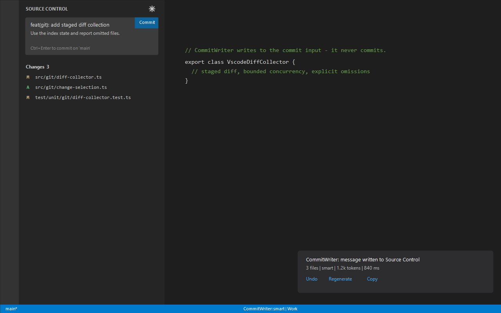
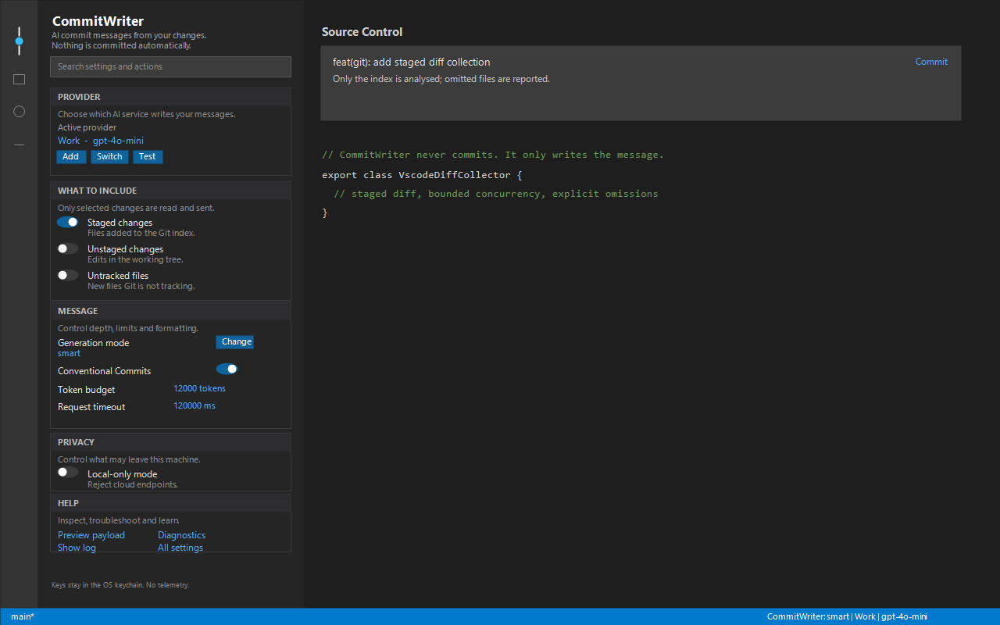

# CommitWriter


**AI commit messages for VS Code, built around your staged diff.**

CommitWriter reads the changes you selected, asks your model for a Conventional Commit message, and writes it into the Source Control input box. You review, edit, and commit. It never commits for you.

[Features](#features) | [Install](#installation) | [Quick start](#quick-start) | [Providers](#supported-providers) | [Settings](#settings-reference) | [Help](HELP.md) | [Support](SUPPORT.md) | [Security](SECURITY.md) | [Privacy](PRIVACY.md) | [Architecture](ARCHITECTURE.md) | [Best practices](BEST_PRACTICES.md) | [Troubleshooting](#troubleshooting) | [FAQ](#faq)

---

## What it does

- Turns a Git change set into one meaningful commit message.
- Uses the AI provider and model you choose, including local models with no account.
- Follows Conventional Commits: `feat`, `fix`, `refactor`, `perf`, `test`, `docs`, `build`, `ci`, `chore`, `revert`.
- Handles repositories from one file to thousands, with explicit limits you control.
- Shows exactly what will be sent, and what was left out.

## Trust and safety

| Guarantee | How it is enforced |
| --- | --- |
| **Never commits** | CommitWriter only writes text into the SCM input box. No commit, stage, amend, revert, or history operation is called. |
| **API keys stay secret** | Keys are stored in VS Code SecretStorage (OS keychain), never in `settings.json`, workspace files, logs, or telemetry. |
| **Secrets are redacted** | Request bodies are scrubbed for API keys, tokens, private keys, JWTs, passwords and connection strings before they leave the machine. |
| **Sensitive files are blocked** | `.env`, key material, `.ssh`, `.aws`, credential stores and similar paths are excluded by default, with a one-run override. |
| **No telemetry** | Version 1 has no telemetry, no analytics, and no background network calls. |
| **Local-only option** | `commitwriter.privacy.localOnly` rejects every non-loopback endpoint, so only Ollama, LM Studio, llama.cpp or vLLM can be reached. |
| **TLS is never weakened** | HTTPS is required for remote endpoints. There is no certificate-validation bypass and redirects are not followed. |
| **No shell execution** | No `git` subprocess, no shell commands, no arbitrary command execution. |
| **Repository cannot hijack credentials** | Provider profiles are machine-scoped, so a repository's `.vscode/settings.json` cannot add or redirect a profile. |
| **Diff content is data** | Diff text is wrapped and treated as untrusted input, never as instructions. |

Read the full [security policy](SECURITY.md) and [privacy statement](PRIVACY.md).

## Features

### Commit messages

- Conventional Commit types with configurable scopes and subject length.
- Optional body and breaking-change footers.
- Grounding checks that keep the message tied to the real files and change kinds.
- Draft protection: Replace, Append or Cancel; Undo restores the previous message.
- Regenerate with the same change snapshot.
- Deterministic local fallback when the model fails.

### Providers and models

- OpenAI, Anthropic (Claude), Google Gemini, DeepSeek, OpenRouter.
- Ollama, LM Studio, llama.cpp server and vLLM for local inference.
- OpenCode local server, reusing its models and auth.
- Any custom OpenAI-compatible endpoint, with configurable API format, auth header and base URL.
- Multiple saved profiles; switch without touching other settings.

### Context control

- Include staged, unstaged and untracked changes independently.
- Exclude files and directories with globs.
- Cap file size, file count, diff lines and total token budget.
- Per-mode overrides for power users.

### Large repositories

- File classification (source, tests, docs, config, lockfiles, generated, binary, assets).
- Directory and monorepo package grouping.
- Token-budgeted diff selection with an always-sent manifest.
- Chunked map-reduce summarization, retries and caching.
- Explicit reports for omitted, truncated or failed files - nothing is silently dropped.

## Screenshots





The CommitWriter icon in the Activity Bar opens a sidebar with providers, change scope, generation limits, privacy toggles and actions.

## Requirements

- VS Code 1.90 or newer on desktop.
- The built-in Git extension enabled.
- Network access to your provider, or a local Ollama / LM Studio / llama.cpp / vLLM / OpenCode server.
- A provider account and API key, except for local servers.

## Installation

**From the Marketplace:** search for **CommitWriter** (publisher `RajatMalik`), or run:

```bash
code --install-extension RajatMalik.commitwriter
```

**From a VSIX:**

```bash
code --install-extension commitwriter-1.0.0.vsix
```

Then reload the window.

> If your Extensions page shows "AI Code Review Export for ChatGPT, Claude, Gemini", that is a different extension named DiffScribe. Install **CommitWriter** instead.

## Quick start

1. Open a Git repository in VS Code.
2. Stage the files you want to commit.
3. Open the CommitWriter icon in the Activity Bar, or run **CommitWriter: Manage Provider Profiles**.
4. Add a provider, enter the API key, choose a model (or use **Select Model**).
5. Run **CommitWriter: Generate Commit Message**, or use the sparkle action in the Source Control title bar.
6. Review and edit the message in the Source Control input box, then commit yourself.

For a fully local setup, start Ollama (or LM Studio / llama.cpp / vLLM), add the matching local provider, and enable **Local-only mode**.

## Supported providers

| Provider | API format | Default endpoint | Key required |
| --- | --- | --- | --- |
| OpenAI | Chat completions | `https://api.openai.com/v1` | Yes |
| Anthropic (Claude) | Messages API | `https://api.anthropic.com` | Yes |
| Google Gemini | `generateContent` | `https://generativelanguage.googleapis.com` | Yes |
| DeepSeek | Chat completions | `https://api.deepseek.com/v1` | Yes |
| OpenRouter | Chat completions | `https://openrouter.ai/api/v1` | Yes |
| Ollama | Native `/api/chat` | `http://127.0.0.1:11434` | No |
| LM Studio | Chat completions | `http://127.0.0.1:1234/v1` | No |
| llama.cpp server | Chat completions | `http://127.0.0.1:8080/v1` | No |
| vLLM | Chat completions | `http://127.0.0.1:8000/v1` | No |
| OpenCode | Local session server | `http://127.0.0.1:4096` | Optional |
| Custom | OpenAI, Anthropic, Gemini or Ollama format | Your URL | Configurable |

## Generation modes

| Mode | Behaviour | Use it when |
| --- | --- | --- |
| **Quick** | One request, subject line only. | Small changes, fast feedback. |
| **Smart** | Chooses single-pass or chunked map-reduce based on the diff. | Everyday use. |
| **Detailed** | Always summarizes files in chunks before writing, with the largest budget. | Large or mixed change sets. |

Set the mode with `commitwriter.mode` or the **Mode** item in the sidebar.

## Choosing what to analyse

Staged, unstaged and untracked changes are independent toggles:

- `commitwriter.context.includeStaged` (default `true`)
- `commitwriter.context.includeUnstaged` (default `false`)
- `commitwriter.context.includeUntracked` (default `false`)

Toggle them in the sidebar under **Changes to analyse**, or in Settings. Additional controls: `excludeGlobs`, `maxFileBytes`, `maxFiles`, `maxDiffTokens`.

## Commands

| Command | What it does |
| --- | --- |
| `CommitWriter: Generate Commit Message` | Generate from the configured change selection |
| `CommitWriter: Generate Commit Message (Staged Only)` | Force the Git index only |
| `CommitWriter: Regenerate Commit Message` | Retry with the same change snapshot |
| `CommitWriter: Cancel Generation` | Stop an in-flight request |
| `CommitWriter: Edit Commit Message` | Reveal the Source Control input box |
| `CommitWriter: Undo Last Generated Message` | Restore the previous input-box text |
| `CommitWriter: Preview Payload To Be Sent` | Inspect the redacted prompt |
| `CommitWriter: Manage Provider Profiles` | Add, edit, remove, switch, test, validate |
| `CommitWriter: Add Provider Profile` | Guided provider setup |
| `CommitWriter: Test Provider Connection` | Check endpoint, key and model list |
| `CommitWriter: Validate Provider Configuration` | Validate every saved profile |
| `CommitWriter: Select Model` | Pick from the provider's model list |
| `CommitWriter: Set API Key` | Store a key in the OS keychain |
| `CommitWriter: Clear API Key` | Remove a stored credential |
| `CommitWriter: Allow Sensitive Files For Next Generation` | One-run override with a warning |
| `CommitWriter: Revoke Egress Consent` | Clear all network consent records |
| `CommitWriter: Show Diagnostics` | Environment and capability summary |
| `CommitWriter: Show Log` | Open the redacted output channel |

## Settings reference

| Setting | Default | Description |
| --- | --- | --- |
| `commitwriter.profiles` | `[]` | Saved provider profiles (machine-scoped) |
| `commitwriter.activeProfileId` | `""` | Active profile |
| `commitwriter.mode` | `smart` | `quick`, `smart` or `detailed` |
| `commitwriter.modes.overrides` | `{}` | Per-mode limits; can only lower ceilings |
| `commitwriter.context.includeStaged` | `true` | Include the Git index |
| `commitwriter.context.includeUnstaged` | `false` | Include working-tree changes |
| `commitwriter.context.includeUntracked` | `false` | Include untracked files |
| `commitwriter.context.maxDiffTokens` | `12000` | Diff token budget |
| `commitwriter.context.maxFiles` | `200` | Maximum files analysed |
| `commitwriter.context.maxFileBytes` | `262144` | Maximum size per file |
| `commitwriter.context.maxFileDiffLines` | `400` | Maximum diff lines per file |
| `commitwriter.context.excludeGlobs` | lockfiles, build output | Additional exclusions |
| `commitwriter.context.additionalExcludeGlobs` | `[]` | Additive exclusions |
| `commitwriter.style.learnFromHistory` | `true` | Sample recent commit subjects |
| `commitwriter.style.historySamples` | `30` | History sample size |
| `commitwriter.conventional.enabled` | `true` | Enforce Conventional Commits |
| `commitwriter.conventional.types` | feat, fix, ... | Allowed types |
| `commitwriter.conventional.maxSubjectLength` | `72` | Subject limit |
| `commitwriter.conventional.requireScope` | `false` | Require a scope |
| `commitwriter.conventional.allowedScopes` | `[]` | Allowed scopes |
| `commitwriter.output.language` | `en` | Message language, or `auto` |
| `commitwriter.output.includeBody` | `true` | Allow commit bodies |
| `commitwriter.output.includeIssueKeyFromBranch` | `false` | Add `Refs: KEY` from the branch |
| `commitwriter.output.attribution` | `none` | Optional `Generated-by` trailer |
| `commitwriter.output.overwriteDraft` | `ask` | `ask`, `replace` or `append` |
| `commitwriter.provider.timeoutMs` | `120000` | Global timeout ceiling |
| `commitwriter.provider.maxRetries` | `2` | Retry budget |
| `commitwriter.privacy.localOnly` | `false` | Reject non-loopback endpoints |
| `commitwriter.statusBar.enabled` | `true` | Show the status bar item |
| `commitwriter.log.level` | `warn` | `off`, `error`, `warn`, `info`, `debug` |

Each profile also supports: label, provider, API format, base URL, model, fallback model, context window, temperature, max output tokens, request timeout, custom headers, auth style and auth header name.

## How it works

```
selected changes
  -> metadata + diffs (bounded, classified)
  -> manifest + token budget
  -> optional chunk summarization (map-reduce)
  -> prompt with untrusted-diff delimiters
  -> provider request (redacted, timeout, cancel)
  -> parse, repair, validate Conventional Commits
  -> Source Control input box
```

No unchanged files are sent. The manifest always lists every analysed file, and every omission is reported to you.

## Troubleshooting

| Symptom | Fix |
| --- | --- |
| Details page shows "AI Code Review Export..." | You installed `diffscribe.diffscribe`. Uninstall it and install **CommitWriter** (`RajatMalik.commitwriter`). |
| Activity-bar icon is missing | Reload the window after installing; the icon is monochrome by design, the Marketplace icon is colourful. |
| "No staged changes" | Stage files, or enable unstaged/untracked analysis. |
| 401 or 403 | Re-enter the API key for the active profile. |
| 429 or quota errors | Wait, reduce the token budget, or use another profile. |
| "Model not found" | Run **Select Model** or correct the model id. |
| Local model connection refused | Start the server and check its port; enable Local-only mode for safety. |
| Message is too generic | Use Detailed mode, stage fewer files, or increase the token budget. |
| Very large repository is slow | Use Smart/Quick, lower `maxFiles`, or raise `excludeGlobs`. |
| Proxy required | Version 1 does not read VS Code proxy settings; use a local model or a reachable endpoint. |

## FAQ

**Does CommitWriter commit for me?** No. It only writes into the input box.

**Does it send my whole repository?** No. Only the selected changed files, within the configured budget.

**Does it store my code?** No. There is no telemetry and no server operated by CommitWriter. Your provider's retention policy applies.

**Can I use it fully offline?** Yes, with a local provider and Local-only mode.

**Which model should I use?** Any chat model the provider offers. Local coding models work well for small diffs.

**Does it work in the web version of VS Code?** No. It requires the desktop extension host and Git.

**Can I keep several providers?** Yes. Profiles are independent, and switching only changes the active one.

**Does it work with monorepos?** Yes. Files are grouped by package or directory.

**Who pays for the API usage?** You, through your provider account.

## Privacy

See [PRIVACY.md](PRIVACY.md) for the exact data flow, what is redacted, and what is never collected.

## Security

See [SECURITY.md](SECURITY.md) for guarantees, the threat model, and how to report a vulnerability.

## Development

Repository: <https://github.com/malikrajat/CommitWriter>

```bash
npm install
npm run verify    # typecheck + lint + tests + build
npm run package   # produce a VSIX
```

```bash
git remote add origin https://github.com/malikrajat/CommitWriter.git
git branch -M main
```

The core engine under `src/core` has no VS Code dependency and is covered by unit tests plus real-Git integration tests. Architecture tests enforce the security invariants.

See [CONTRIBUTING.md](CONTRIBUTING.md), [DEVELOPMENT.md](DEVELOPMENT.md) and [ARCHITECTURE.md](ARCHITECTURE.md) for details.

## Documentation

| Document | Contents |
| --- | --- |
| [README](README.md) | Features, install, providers, commands, settings, FAQ |
| [HELP](HELP.md) | Task-oriented usage and common problems |
| [SUPPORT](SUPPORT.md) | Where to get help and how to report issues |
| [ARCHITECTURE](ARCHITECTURE.md) | Layers, data flow, contracts, invariants |
| [BEST_PRACTICES](BEST_PRACTICES.md) | Safe, cost-effective usage and contributor rules |
| [SECURITY](SECURITY.md) | Security model, threat model, reporting |
| [PRIVACY](PRIVACY.md) | Data flow, redaction, consent, storage |
| [DEVELOPMENT](DEVELOPMENT.md) | Setup, layout, adding providers, testing |
| [CONTRIBUTING](CONTRIBUTING.md) | Contribution workflow |
| [CODE_OF_CONDUCT](CODE_OF_CONDUCT.md) | Community standards |
| [CHANGELOG](CHANGELOG.md) | Release history |
| [RELEASE](RELEASE.md) | Maintainer release checklist |
| [NOTICE](NOTICE.md) | Third-party notices and trademarks |
| [LICENSE](LICENSE) | MIT license |

## License

MIT. See [LICENSE](LICENSE).


